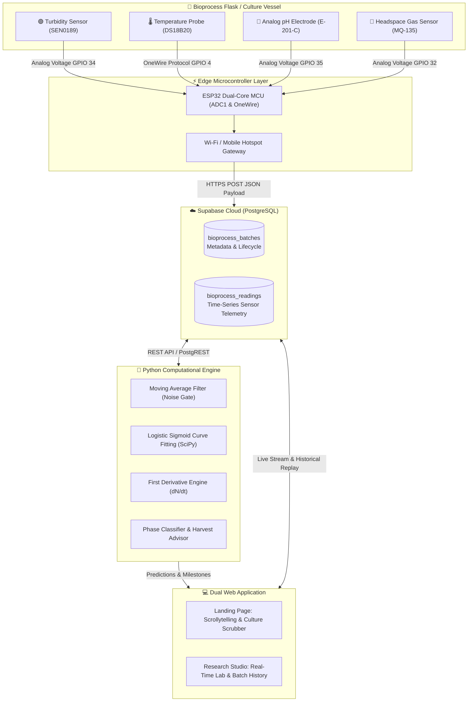
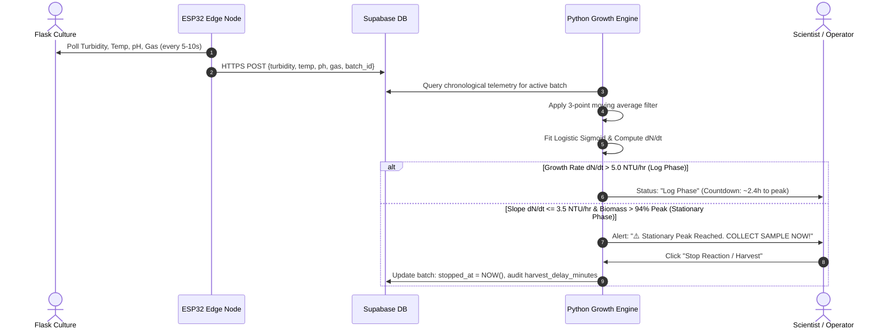
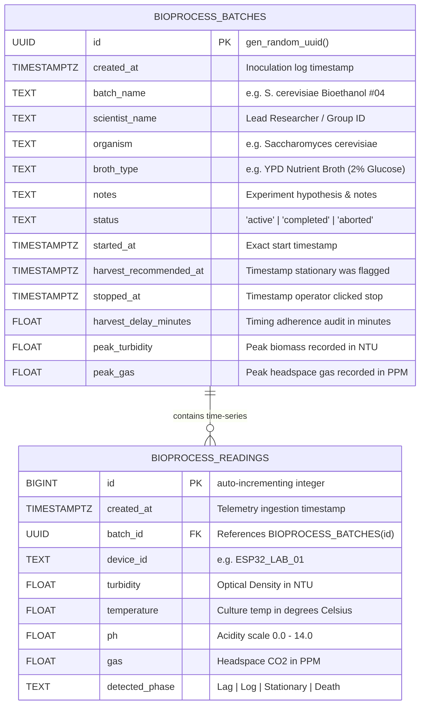

<div align="center">

# 🧪 IoT-Based Bioprocess Monitoring & Growth Prediction System
### Autonomous Cyber-Physical Fermentation Platform & Predictive Harvest Engine

[](https://github.com)
[](https://python.org)
[](https://flask.palletsprojects.com/)
[](https://supabase.com)
[](https://espressif.com)
[](https://tailwindcss.com)
[](https://chartjs.org)

<p align="center">
  <b>A production-grade, full-stack cyber-physical system bridging Biotechnology, Embedded IoT, Cloud PostgreSQL, and Mathematical Sigmoidal Modeling to monitor live microbial cultures, classify growth phases, and trigger optimal harvest windows.</b>
</p>

[Explore Landing Page](http://localhost:5000/) • [Enter Research Studio](http://localhost:5000/research) • [Database Schema](cloud/supabase_schema.sql) • [ESP32 Firmware](firmware/esp32_supabase_sample.ino)

---

</div>

## 📑 Table of Contents
- [Executive Overview](#-executive-overview)
- [System Architecture & Data Flow](#-system-architecture--data-flow)
- [Technology Stack Matrix](#-technology-stack-matrix)
- [Bioprocess Growth Modeling & Mathematical Engine](#-bioprocess-growth-modeling--mathematical-engine)
- [Relational Database Schema (PostgreSQL / Supabase)](#-relational-database-schema-postgresql--supabase)
- [Hardware Architecture & Sensor Pinout](#-hardware-architecture--sensor-pinout)
- [Web Application Architecture (Dual-Page)](#-web-application-architecture-dual-page)
- [Directory Structure](#-directory-structure)
- [Installation & Quick Start Guide](#-installation--quick-start-guide)
- [Firmware Setup (Arduino IDE)](#-firmware-setup-arduino-ide)
- [Cloud Deployment (Render / Railway)](#-cloud-deployment-render--railway)
- [Evaluation & Defense Q&A (Viva Guide)](#-evaluation--defense-qa-viva-guide)

---

## 🔬 Executive Overview

In academic biotechnology and industrial bioreactor facilities, batch culture parameters (cell concentration, culture broth temperature, metabolic acidification, and dissolved/headspace respiration gas) are conventionally audited through **manual physical sampling**. Manual sampling exposes cultures to contamination risks, introduces sampling latency, and often misses the narrow **stationary peak harvest window** prior to cell lysis and death.

This project delivers an automated **End-to-End Cyber-Physical System (CPS)**:
1. **Submerged & Headspace Sensing:** 4 physical sensors continuously measure Optical Turbidity (Biomass proxy), Digital Temperature, pH Acidity, and Headspace Respiration Off-Gas ($CO_2$).
2. **Edge Computing:** An **ESP32** microcontroller digitizes analog/digital signals, runs calibration math, and transmits JSON telemetry directly over HTTPS to the cloud.
3. **Relational Batch Storage:** **Supabase Cloud (PostgreSQL)** maintains a clean separation between **Experiment Batches** and **Time-Series Telemetry Packets**.
4. **Predictive Analytics:** A Python analytics engine fits incoming data to the **Logistic Sigmoid Equation** ($N(t)$) using non-linear least squares (`scipy.optimize.curve_fit`), computes the first derivative ($\frac{dN}{dt}$), and issues real-time **Harvest Recommendations**.
5. **Dual Web Interface:**
   - **Interactive Landing Page:** Featuring scrollytelling of biological phases, parallel scrolling, and an interactive culture simulation scrubber.
   - **Research Studio:** Complete with batch initiation forms, stop/harvest audit recording, and 1-click historical replay.

---

## 🏛 System Architecture & Data Flow



---

## 🛠 Technology Stack Matrix

| Layer | Technology | Version | Purpose & Architectural Rationale |
| :--- | :--- | :--- | :--- |
| **Edge Hardware** | **ESP32 NodeMCU-32S** | Rev 1 | 240MHz dual-core Xtensa LX6, built-in 2.4GHz Wi-Fi, 12-bit ADC1 channels. |
| **Firmware** | **Arduino C++** | v2.0+ | Low-latency sampling, hardware timers, `WiFiClientSecure` HTTPS REST dispatch. |
| **Cloud Database** | **Supabase / PostgreSQL** | v15 | Relational integrity, foreign-key batch linking, Row-Level Security (RLS). |
| **Web Server** | **Python Flask** | v3.0.3 | Lightweight asynchronous REST API and dual static page delivery. |
| **Scientific AI** | **SciPy & NumPy** | v1.11+ | Non-linear curve fitting (`curve_fit`), numeric differentiation ($\frac{dN}{dt}$). |
| **Data Processing**| **Pandas** | v2.2+ | In-memory time-series slicing, rolling window noise filtration. |
| **Styling** | **Tailwind CSS** | v3.4 (CDN) | Responsive mobile-first utility layout, glassmorphic dark-mode palette. |
| **Data Visualization**| **Chart.js** | v4.4 | High-performance canvas graphs with multi-axis synchronization and predictive projection. |

---

## 🧠 Bioprocess Growth Modeling & Mathematical Engine

Microbial organisms in a closed liquid culture (batch fermentation) undergo 4 deterministic biological stages:

$$\text{Lag Phase} \xrightarrow{\text{Enzyme Induction}} \text{Log Phase} \xrightarrow{\text{Binary Fission Surge}} \text{Stationary Phase} \xrightarrow{\text{Peak Biomass (Harvest)}} \text{Death Phase}$$

```
    Turbidity (NTU) / Biomass
        ▲
   800 ─┼──────────────────────────────╭───────────────╮
        │                              │  Stationary   │\
   600 ─┼                             ╭╯ (Peak Yield)  │ \  Death Phase
        │                            ╭╯                │  \ (Cell Lysis)
   400 ─┼                           ╭╯                 │   \
        │              Log Phase   ╭╯  dN/dt → 0       │    \
   200 ─┼             (Exponential)│   Optimal Harvest │     ▼
        │             ╭────────────╯
   100 ─┼─────────────╯ Lag Phase (Adaptation)
        └────────────────────────────────────────────────────────► Time (Hours)
        0.0h         2.0h          4.5h               8.5h      11.0h
```

### 1. The Logistic Growth Model
The optical density ($N$) as a function of elapsed time ($t$) is modeled via the **Sigmoidal Logistic Equation**:

$$N(t) = N_0 + \frac{K - N_0}{1 + e^{-r(t - t_0)}}$$

* $N(t)$: Predicted Optical Density / Turbidity at incubation hour $t$.
* $K$: Environmental carrying capacity (theoretical maximum biomass yield).
* $N_0$: Initial turbidity at inoculation ($t = 0.0\text{h}$).
* $r$: Intrinsic growth rate coefficient ($\text{hr}^{-1}$).
* $t_0$: Sigmoid midpoint (inflection point of maximum growth velocity).

### 2. Numerical Differentiation & Harvest Decision Logic
To determine the optimal harvest window without human bias, the engine calculates the first derivative:

$$\frac{dN}{dt} = \frac{N(t_i) - N(t_{i-1})}{\Delta t}$$



### 3. Automated Phase Classification Rubric

| Growth Phase | Biological State | Sensor Behavioral Signature | Automated Decision Trigger |
| :--- | :--- | :--- | :--- |
| **1. Lag Phase** | Cellular enzyme synthesis; adjusting to nutrient broth. | Turbidity flat ($\Delta < 45\text{ NTU}$); baseline gas (~420 PPM); pH stable (~7.05). | *"Culture adapting. Maintain incubation temperature."* |
| **2. Log (Exponential)** | Rapid cellular division via binary fission. | Steep turbidity rise ($\frac{dN}{dt} > 5\text{ NTU/hr}$); gas surges >2500 PPM; pH drops rapidly. | *"Vigorous division active (+15%/hr). Prepare harvesting tools."* |
| **3. Stationary Phase** | Nutrient depletion; population hits peak carrying capacity. | Turbidity slope flattens ($\frac{dN}{dt} \to 0$); gas evolution plateaus. | **"⚠️ Optimal Harvest Window Reached! Collect sample immediately."** |
| **4. Death Phase** | Autolysis; accumulation of toxic metabolic byproducts. | Turbidity drops $> 25\text{ NTU}$ below peak; gas production ceases. | *"Viability declining. Harvest remaining biomass immediately."* |

---

## 🗄 Relational Database Schema (PostgreSQL / Supabase)

The database utilizes a **Two-Table Relational Schema** with a cascade foreign key:



---

## 🔌 Hardware Architecture & Sensor Pinout

```
                           ┌──────────────────────────┐
                           │      ESP32 30-PIN        │
                           │       NodeMCU-32S        │
                           │                          │
  SEN0189 Turbidity (Signal)──► GPIO 34 (ADC1_CH6)    │
  Analog pH Sensor (Signal)───► GPIO 35 (ADC1_CH7)    │
  MQ-135 Gas Sensor (Signal)──► GPIO 32 (ADC1_CH4)    │
  DS18B20 Temp Probe (Data)───► GPIO 4  (OneWire Bus) │◄─── 4.7kΩ Pull-Up to 3.3V
                           │                          │
                 5.0V / 3.3V──► VCC / VIN             │
                         GND──► Common Ground         │
                           └──────────────────────────┘
```

### Sensor Specifications Table

| Sensor | Model / Type | Interface | Working Range | Biological Role in Culture |
| :--- | :--- | :--- | :--- | :--- |
| **Optical Turbidity** | SEN0189 / Photodiode | GPIO 34 (Analog) | 0.0 – 1000.0 NTU | Quantifies light scattering as proxy for microbial cell count. |
| **Digital Temperature** | DS18B20 Waterproof | GPIO 4 (OneWire) | -55°C to +125°C ($\pm 0.5^\circ\text{C}$) | Ensures enzymatic stability (target 30–36°C) and detects metabolic heat. |
| **Analog pH Probe** | E-201-C / 4502C Mod | GPIO 35 (Analog) | 0.0 – 14.0 pH | Tracks broth acidification as microbes secrete organic acids. |
| **Headspace Gas Sensor**| MQ-135 / Electrochemical | GPIO 32 (Analog) | 400 – 4000 PPM | Measures $CO_2$ and volatile metabolites from cellular respiration. |

---

## 🖥 Web Application Architecture (Dual-Page)

The web client is decoupled into two purpose-built views:

```
                            http://localhost:5000/
                                       │
            ┌──────────────────────────┴──────────────────────────┐
            ▼                                                     ▼
┌──────────────────────────────────────┐  ┌──────────────────────────────────────┐
│ Page 1: Landing Page (/)             │  │ Page 2: Research Studio (/research)  │
├──────────────────────────────────────┤  ├──────────────────────────────────────┤
│ • Sticky Navigation & Glassmorphic UI│  │ • Active Experiment Status Banner    │
│ • Parallax Hero Section              │  │ • "▶ Start New Reaction" Modal       │
│ • Horizontal Scrolling Feature Rail  │  │ • "🛑 Stop Reaction" (Harvest Audit) │
│ • Scrollytelling of 4 Growth Stages  │  │ • 6-Card Lifecycle Milestones Track  │
│ • Interactive Culture Scrubber:      │  │ • 5 Real-Time Telemetry Cards        │
│   (Drag time 0-10h, observe animated │  │ • Microbial Growth Curve (with fitted │
│    flask cloudiness, pH drop & gas)  │  │   predictive sigmoid projection)      │
│ • Hardware Sensor Pinout Showcase    │  │ • First Derivative Graph (dN/dt)     │
│ • 1-Click CTA: "Enter Studio →"      │  │ • 3-Axis Environmental Trends Chart  │
│                                      │  │ • Horizontal Quick Batch Carousel    │
│                                      │  │ • 1-Click Historical Replay Mode     │
└──────────────────────────────────────┘  └──────────────────────────────────────┘
```

---

## 📁 Directory Structure

```text
IDEA-LAB 1st SEM STUDENT PROJECT/
├── backend/
│   ├── app.py                      # Flask REST API & Web Server (Endpoints for batches, telemetry, replay)
│   ├── config.py                   # Environment configuration (Supabase URL, Anon Key, table names)
│   ├── requirements.txt            # Python dependencies (Flask, SciPy, NumPy, Pandas, Requests)
│   └── services/
│       ├── growth_engine.py        # Non-linear curve fitting, derivative analysis & milestone detection
│       ├── simulator.py            # Biological batch fermentation simulator (Lag, Log, Stationary, Death)
│       └── supabase_service.py     # Relational multi-batch lifecycle manager & PostgREST client
├── frontend/
│   ├── index.html                  # High-End Professional Landing Page (Scrollytelling & Scrubber)
│   ├── research.html               # Live Research Studio (Reaction modal, Milestones, History Replay)
│   ├── css/
│   │   ├── landing.css             # Landing page animations, horizontal scroll track, culture vessel
│   │   └── style.css               # Studio theme, glows, phase badges, glassmorphic panels
│   └── js/
│       ├── api.js                  # Frontend API client (Batch lifecycle & Telemetry REST calls)
│       ├── charts.js               # Growth curve, derivative dN/dt, and 3-axis Env/Gas graphs
│       ├── app.js                  # Studio controller (New batch modal, Stop reaction, History replay)
│       └── landing.js              # Interactive culture scrubber sandbox & scrollytelling observers
├── cloud/
│   └── supabase_schema.sql         # Relational schema (bioprocess_batches + bioprocess_readings)
├── firmware/
│   └── esp32_supabase_sample.ino   # Complete ESP32 C++ sketch for Wi-Fi & HTTPS POST
├── run.py                          # One-click launcher script with browser auto-open
├── .env.example                    # Configuration template for Supabase credentials
├── .gitignore                      # Git exclusion rules
└── README.md                       # Comprehensive project documentation
```

---

## 🚀 Installation & Quick Start Guide

### Prerequisites
* **Python 3.10 or higher** installed.
* **Arduino IDE 2.x** (if uploading firmware to physical ESP32).

### Step 1: Clone or Navigate to Directory
```bash
cd "d:\PROJECTS(CODE)\IDEA-LAB 1st SEM STUDENT PROJECT"
```

### Step 2: Install Python Dependencies
```bash
pip install -r backend/requirements.txt
```

### Step 3: Run the Application
```bash
python run.py
```
* **Landing Page:** [http://localhost:5000/](http://localhost:5000/)
* **Live Research Studio:** [http://localhost:5000/research](http://localhost:5000/research)

> **Simulation Mode Active by Default:** If you run without database credentials, the application auto-engages the **Synthetic Biological Simulator**. You can evaluate the entire pipeline, start/stop reactions, and replay past experiments without hardware attached!

---

## ⚡ Connecting to Supabase Cloud

1. Create a free project at [supabase.com](https://supabase.com).
2. Open the **SQL Editor** in your Supabase project dashboard.
3. Copy the entire contents of [`cloud/supabase_schema.sql`](cloud/supabase_schema.sql), paste into the editor, and click **RUN**.
4. Retrieve your **Project URL** and **anon / public key** from **Project Settings $\to$ API**.
5. Configure the credentials:
   - **Method A (GUI Modal):** Click **`⚙️ Supabase Config`** in the top right of the web app, paste the URL & Key, and click **Save & Connect**.
   - **Method B (`.env` file):**
     ```env
     SUPABASE_URL=https://your-project-id.supabase.co
     SUPABASE_KEY=your-supabase-anon-key
     SUPABASE_TABLE=bioprocess_readings
     SUPABASE_BATCHES_TABLE=bioprocess_batches
     ```

---

## 📟 Firmware Setup (Arduino IDE)

1. Open [`firmware/esp32_supabase_sample.ino`](firmware/esp32_supabase_sample.ino) in the **Arduino IDE**.
2. Install the required libraries via the **Library Manager** (`Ctrl + Shift + I`):
   - `DallasTemperature` by Miles Burton
   - `OneWire` by Paul Stoffregen
3. Set your Wi-Fi credentials and Supabase endpoint:
   ```cpp
   const char* WIFI_SSID         = "Lab_WiFi_Or_Phone_Hotspot";
   const char* WIFI_PASSWORD     = "Your_WiFi_Password";
   const char* SUPABASE_REST_URL = "https://YOUR_PROJECT_ID.supabase.co/rest/v1/bioprocess_readings";
   const char* SUPABASE_ANON_KEY = "YOUR_SUPABASE_ANON_KEY";
   ```
4. Select **Board:** `ESP32 Dev Module` $\to$ **Port:** COMx $\to$ Click **Upload**.

---

## 🌐 Cloud Deployment (Render / Railway)

The project is structured for 1-click cloud deployment:

### Deploying on Render (Free Web Service)
1. Push this repository to **GitHub**.
2. Go to [render.com](https://render.com) $\to$ Select **New +** $\to$ **Web Service**.
3. Link your GitHub repository.
4. Configure settings:
   - **Environment:** `Python 3`
   - **Build Command:** `pip install -r backend/requirements.txt`
   - **Start Command:** `python run.py` (or `gunicorn backend.app:app`)
5. In **Environment Variables**, define `SUPABASE_URL` and `SUPABASE_KEY`.
6. Click **Deploy**!

---

## 🎓 Evaluation & Defense Q&A (Viva Guide)

### Q1: Why use an ESP32 instead of an Arduino Uno?
> **Answer:** The Arduino Uno operates on an 8-bit ATmega328P with only 2KB SRAM and no wireless connectivity. The ESP32 features a 240MHz dual-core 32-bit processor, 520KB SRAM, built-in 2.4GHz Wi-Fi, hardware TLS/SSL acceleration for secure HTTPS POST requests directly to cloud databases, and multiple 12-bit ADC channels.

### Q2: How does the system predict growth rather than merely displaying values?
> **Answer:** Rather than acting as a static gauge, the Python engine takes a sliding time-series window of optical turbidity readings, eliminates bubble and sensor noise using moving-average filtering, and fits the data to the **Logistic Sigmoid Equation** ($N(t)$). By calculating the first derivative ($\frac{dN}{dt}$), the engine detects the biological inflection point and monitors the slope flattening towards zero ($\frac{dN}{dt} \approx 0$) to forecast peak biomass and harvest timing hours in advance.

### Q3: Why is a headspace gas sensor ($CO_2$) included alongside optical turbidity?
> **Answer:** Optical turbidity is a measure of physical cell density and light scattering, which can plateau even as cells begin to die (intact lysed cell walls still scatter light). Respiration off-gas ($CO_2$ in PPM) directly measures **metabolic viability**. When cellular division slows at the stationary phase, respiration simultaneously levels off, providing cross-verification of culture kinetics.

### Q4: How does multi-batch management operate without reflashing the ESP32?
> **Answer:** We implemented a two-table relational architecture (`bioprocess_batches` + `bioprocess_readings`). When a scientist initiates a new reaction in the Research Studio, a new batch is set to `status = 'active'`. The backend automatically tags all incoming ESP32 packets with the active `batch_id`. When stopped, harvest adherence is audited and the batch is archived for historical replay.

---

<div align="center">

**Developed for AICTE IDEA Lab 1st Semester Interdisciplinary Engineering Evaluation**  
*Biotechnology • Internet of Things • Cloud Computing • Data Science*

</div>
